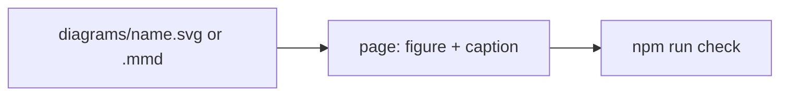

A diagram earns its place by showing a mechanism. If it does not, delete it. Start from `templates/diagram.md`.

## Two kinds of diagram

- **Mermaid** for flowcharts and sequence diagrams inside a page: a fenced code block with the language `mermaid`. The site renders it in the reader's browser and follows the light and dark theme. A Mermaid diagram that is reused or long keeps its source in `diagrams/<name>.mmd`.
- **Hand-authored SVG** for hero diagrams, in `diagrams/<name>.svg`. Colours use the palette variables below, each with its light-theme value as a fallback, for example `fill: var(--ha-ink, #1b1d22)`, so the diagram follows the site theme and still reads when the file is opened on its own. Import it into a page as a component so it is inlined, inside `<figure class="diagram">`.

A minimal Mermaid block:

The path every diagram takes: its source file goes into a page with a figure and a caption, and the page is built and checked by `npm run check`.

## Caption

Every diagram has a caption (`<figcaption>`, or the sentence directly under a Mermaid block) that states the claim the diagram supports, in one or two sentences. A caption that only names the picture ("Architecture overview") is not enough. Any number in the diagram names its source in the caption or in a footnote; a number without a source is not drawn.

## Alt text

Follows the WAI images tutorial (https://www.w3.org/WAI/tutorials/images/).

- A hand-authored SVG carries `role="img"`, a `<title>` (the short alternative) and a `<desc>` (the long one), both referenced from `aria-labelledby`. Diagrams are complex images, so `<desc>` says what the diagram shows, not only what it is.
- An `` always has an `alt` attribute. `alt=""` is only for decoration, and diagrams are not decoration. The build fails on an `` without `alt` (`scripts/check-sources.mjs`, run after every build).
- A Mermaid block is described in the text next to it, so a reader who cannot see it loses nothing.

## Palette

Four neutrals and two accents. The accents mark measured half-lives only: `--ha-short` for a short half-life, `--ha-long` for a long one. Every foreground colour is at least 4.5:1 against both background colours in both themes; `tests/diagrams.test.mjs` checks the ratios. The values live in `src/styles/diagrams.css`.

| Variable | Role | Dark theme | Light theme |
|---|---|---|---|
| `--ha-surface` | background | `#17181c` | `#ffffff` |
| `--ha-fill` | box fill | `#24262d` | `#eef0f3` |
| `--ha-line` | strokes, secondary text | `#a3a8b4` | `#5c6270` |
| `--ha-ink` | text | `#eceef2` | `#1b1d22` |
| `--ha-short` | accent: short half-life | `#ff9e6e` | `#a8411a` |
| `--ha-long` | accent: long half-life | `#73c7ea` | `#1c6690` |

Mermaid diagrams use Mermaid's own `default` and `dark` themes, switched with the site theme; they do not use this palette.

## Sources

The source of every diagram is committed next to any rendered output: the `.svg` is its own source, a `.mmd` file sits next to any image exported from it.
