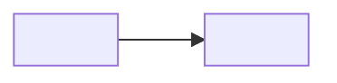

<!-- Diagram template. Rules: docs/diagram-convention.md. Replace every <...> placeholder. -->

## Checklist

- [ ] It shows a mechanism; otherwise delete it.
- [ ] Caption states the claim it supports.
- [ ] Every number names its source (URL and access date), or is not drawn.
- [ ] SVG: `role="img"`, `<title>`, `<desc>`, `aria-labelledby`; colours from the palette with light fallbacks.
- [ ] Source committed next to any rendered output.

## Hand-authored SVG (`diagrams/<name>.svg`), in an `.mdx` page

```mdx
import <Name> from '<relative path>/diagrams/<name>.svg';

<figure class="diagram">
  <<Name> />
  <figcaption><CLAIM THE DIAGRAM SUPPORTS></figcaption>
</figure>
```

```svg
<svg xmlns="http://www.w3.org/2000/svg" viewBox="0 0 <W> <H>" role="img" aria-labelledby="<name>-title <name>-desc">
  <title id="<name>-title"><SHORT ALTERNATIVE></title>
  <desc id="<name>-desc"><WHAT THE DIAGRAM SHOWS, ELEMENT BY ELEMENT></desc>
  <style>
    .<prefix>-text { fill: var(--ha-ink, #1b1d22); }
  </style>
</svg>
```

## Mermaid, in any page

````md


<CLAIM THE DIAGRAM SUPPORTS, AND WHAT IT SHOWS FOR A READER WHO CANNOT SEE IT>
````
